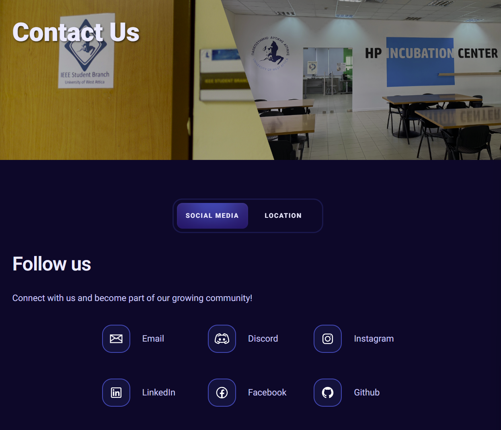
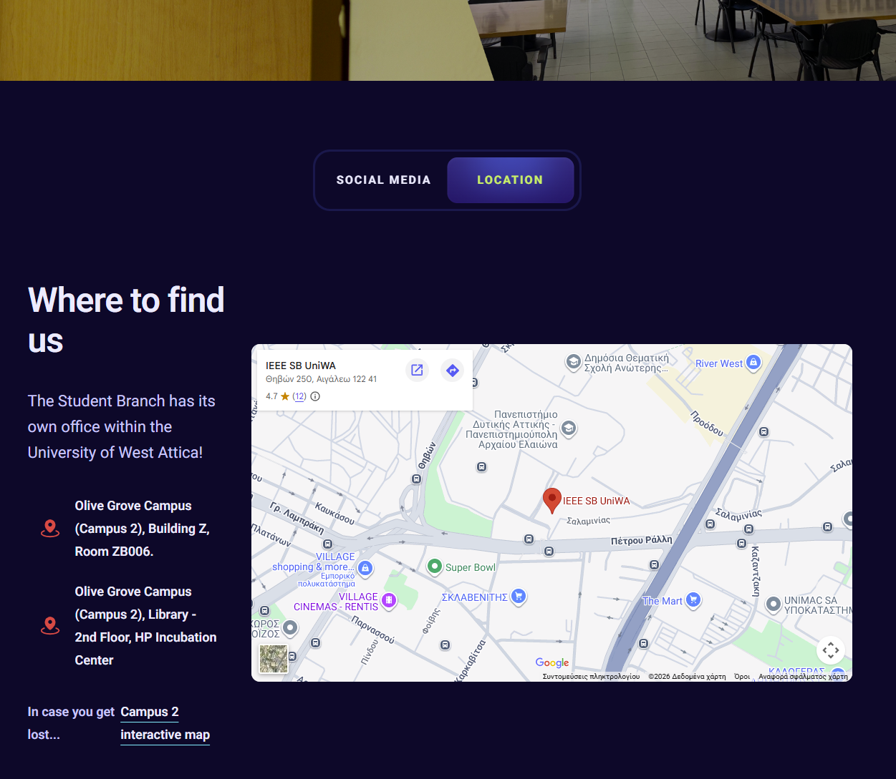

# Component Documentation: Contact Page

## 1. High-Level Overview

- **Component Name:** `ContactPage` (Next.js Page Component)
- **File Location:** `app/contact/page.jsx`
- **Description:** A client-side Next.js page component that serves as the application's contact page. It features an introductory banner and an interactive toggle that allows users to switch between a list of social media links and an interactive map.
- **Owner/Author:** [@Stavrianna Leontzakou]

## 2. Visuals & Examples

- **Screenshots:**
  - _[]_
  - _[]_

## 3. State & Hooks

Because this is a top-level page component, it relies on internal state and hooks rather than incoming props.

- **`useTranslations("ContactPage")` (next-intl):** Fetches localized strings for the page heading, subheading, and the text for the toggle buttons (`option_1` and `option_2`).
- **`socialMedia` (useState):** \* **Type:** `boolean`
  - **Default:** `true`
  - **Description:** Controls the main view of the page. When `true`, the `SocialsList` is rendered. When `false`, the `MapWrapper` is rendered.

## 4. Usage Guide

This component acts as a route page in Next.js. It does not need to be imported and rendered manually by other components. Simply place it in the appropriate route directory (e.g., `src/app/contact/page.jsx`).

```jsx
// Standard Next.js Route Usage
// Navigation to /contact will automatically render this component.
```

## 5. Dependencies & Relationships

- **External Packages:** \* `next-intl`: Used for internationalization/translations.
  - `React`: Requires `useState` for the toggle functionality.
- **Child Components:**
  - `<PageIntro />`: Displays the top banner (`url`, `heading`, `subheading`).
  - `<ToggleButton />`: The interactive switch controlling the local state.
  - `<SocialsList />`: Renders when `socialMedia` is `true`. Takes `socials` constant as a prop.
  - `<MapWrapper />`: Renders when `socialMedia` is `false`.
- **Data Sources:** \* Imports `socials` data from `../../../constants/constants.js`.

## 6. Edge Cases & Known Limitations

- **Hardcoded Assets:** The `PageIntro` component relies on a hardcoded image path (`/assets/photos/ieee-contact.png`). If this file is moved or deleted from the `public` directory, the banner image will break.
- **Translation Dependencies:** If the `"ContactPage"` namespace or specific keys (`heading`, `subheading`, `option_1`, `option_2`) are missing from the locale dictionaries, `next-intl` will likely fall back to rendering the raw key names instead of actual text.
- **Component Loading:** The `MapWrapper` and `SocialsList` are conditionally rendered. Any heavy loading (like fetching map tiles via an API) inside `MapWrapper` will occur every time the user toggles to the map view, as the component mounts and unmounts. Ensure `MapWrapper` handles its own loading states gracefully.
